<p align="center">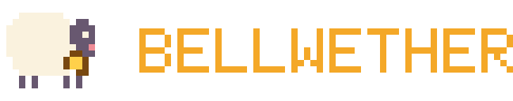</p>

<p align="center">
  <b>Your AI coding agents, as a party of tiny pixel characters.</b><br>
  A desktop and stream overlay for Claude Code, GitHub Copilot CLI and anything that can run a command.
</p>

<p align="center">
  <a href="https://www.npmjs.com/package/@pelotto-tech/bellwether"></a>
  <a href="https://github.com/Pelotto-Technologies/bellwether/actions/workflows/ci.yml"></a>
  <a href="LICENSE"></a>
</p>

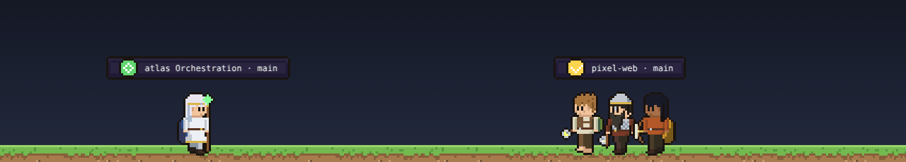

Run a few coding agents at once and it gets hard to tell which one is working, which one
finished and which one is stuck waiting on you. Bellwether turns each agent session into a
little character walking along the bottom of your screen, grouped into parties by working
directory. At a glance you can see who is working, who is done, and who is blocked.

It works with Claude Code and GitHub Copilot CLI through their hooks, and with anything else
that can run a command (`bellwether emit`). No other software is needed. It comes in four art
styles.

[Herdr](https://herdr.dev) is an optional power-up. When it is running, Bellwether also reads
Herdr's workspaces, so you can click a character to focus its pane, prompt agents from the
overlay, and see agents' messages to each other as chat bubbles.

- [Quickstart](#quickstart)
- [A tour](#a-tour): reading the strip, sizes, map mode, camp, agents talking, fellowships
- [Skins](#skins): Workshop Crew, Aesir, Wayfarers, Deep Space
- [Giving agents a role](#giving-agents-a-role)
- [Where to show it](#where-to-show-it): desktop, OBS, browser
- [Configuration](#configuration) and [CLI reference](#cli-reference)

## Quickstart

You need Node 20+ and Claude Code or GitHub Copilot CLI. No Herdr required.

```sh
npm i -g @pelotto-tech/bellwether

bellwether install --events   # activity hooks for Claude Code and Copilot CLI
bellwether overlay            # the desktop overlay, with a tray menu
```

Start (or restart) an agent session and a character appears. The first `bellwether overlay`
downloads Electron into `~/.bellwether/electron` (about 100 MB, once). Prefer a browser tab
or OBS? `bellwether run` serves the same overlay at <http://127.0.0.1:7341/>.

Letting a coding agent do the setup? Point it at [`RECIPE.md`](RECIPE.md).

Want to look before connecting anything? From a checkout, `pnpm install && pnpm mock` serves
fake agents on the same port.

### Using Herdr?

Run `bellwether install` (or `install --events`, which includes it) to add role tags and
chat hooks for your agents, then `bellwether overlay` as before. At startup Bellwether looks
for a running Herdr and uses it when it finds one; otherwise it reads the agent events
file. To force one, pass `--live` or `--hooks`, or set `source` in `bellwether.toml`
(see [Configuration](#configuration)). The two are not merged: with Herdr running you see
Herdr's agents, not the hooks-only sessions.

Already installed? After upgrading, run `bellwether install` again so your agents get the
newest hooks (chat bubbles need the one added in 0.1.11).

## Without Herdr

Bellwether draws your agents straight from their own hooks: Claude Code (CLI and local Code
sessions in the desktop app, subagents included), GitHub Copilot CLI, and any other tool
through a small event format. Each session is an agent, each working directory a party, and
subagents show up as extra agents under their session while they run.

```sh
npm i -g @pelotto-tech/bellwether@latest
bellwether install --events      # adds activity hooks to Claude Code and Copilot CLI
bellwether install --statusline  # optional, Claude Code: context and quota bars, model, quest (see Vitals)
bellwether overlay               # uses the events file when Herdr is not running
```

Prefer a Claude Code plugin to editing settings? Skip `--events` and use:

```
/plugin marketplace add Pelotto-Technologies/bellwether
/plugin install bellwether@bellwether
```

Pick one of the two, not both. `bellwether uninstall` removes everything `install` wrote.

**Roles without Herdr.** A session is a generic agent, or an orchestrator while it has
subagents running. To set one explicitly, use `BELLWETHER_ROLE=reviewer` in its environment, or
start Claude Code with `claude --agent <name>` (names like `reviewer` or `architect` map to
roles). Subagents take a role from their type: `Explore` is a researcher, `Plan` an architect.

**Other tools.** Anything that can run a command can show up:

```sh
bellwether emit --ev start --agent my-factory --session job-42 --cwd ~/code/app --role implementer
bellwether emit --ev tool --session job-42 --detail "Run migrations"
bellwether emit --ev sub_start --session job-42 --sub w1 --sub-type reviewer --detail "Check the diff"
```

Or append JSON lines yourself. The format is in [`docs/EVENTS.md`](docs/EVENTS.md).

Event lines hold a tool name and file (never prompt text) in `~/.bellwether/events.jsonl`. They
cover sessions on this machine only; cloud sessions are not visible, and clicking an agent to
focus it or prompt it needs Herdr. Details in [`plugins/bellwether`](plugins/bellwether/README.md).

## A tour

### Reading the strip

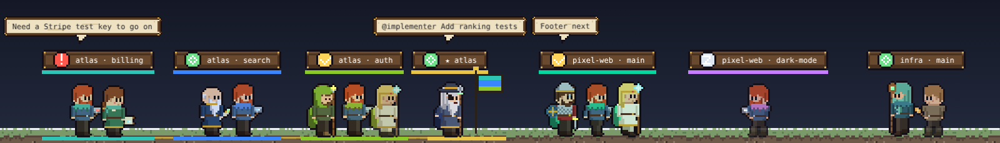

- **Each nameplate is a party**: one Herdr workspace, labelled `workspace · branch`. The icon
  on the left is the party's overall status.
- **One member carries a beacon** whose light is the party's status: green working, yellow
  done, pulsing red blocked, white idle, grey unknown. Working members walk, blocked ones
  stop and raise a hand, finished ones wave, idle ones blink.
- **Worktrees get a tint.** When a repo has several parties, each worktree gets its own
  colour on cloaks, nameplate underline and ground tether, so `atlas · auth` and
  `atlas · search` are easy to tell apart.
- **The orchestrator leads.** An `orchestrator` with other agents in its repo walks in front
  carrying a banner striped in every worktree's colour (`★ atlas` above).
- **Speech bubbles** show what agents say, including messages one agent sends another
  (`@implementer Add ranking tests`).

New agents and worktrees arrive with a short spawn animation (skipped when your OS asks for
reduced motion). Double-click a member in a browser tab to jump Herdr to that pane.

### Sizes and labels

Pick a size from the tray menu (Tiny, Compact, Normal, Large), with `scale` in
`bellwether.toml`, or `?scale=1` to `6` in the URL.

| Tiny | Large |
|---|---|
| 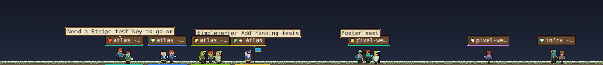 | 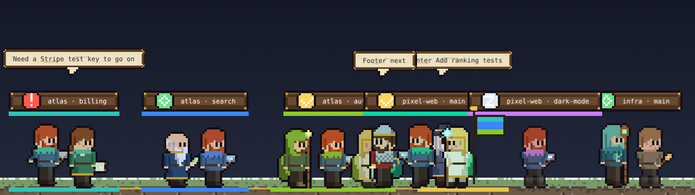 |

For a quieter strip, **Icon only** labels drop the nameplates and put a small status icon
under each party's feet (`minimal = true`, or Labels in the tray menu):

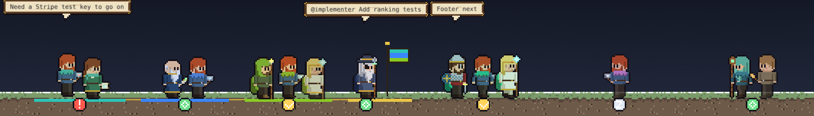

### Crowds and multiple monitors

Parties roam the whole strip on a few depth rows, so they cross paths and pass behind each
other; two parties on the same row bump and turn around. When the strip fills up, more rows
open (up to four) and everyone keeps walking. The back rows stand in the shade and the
ground gets deeper to hold them:

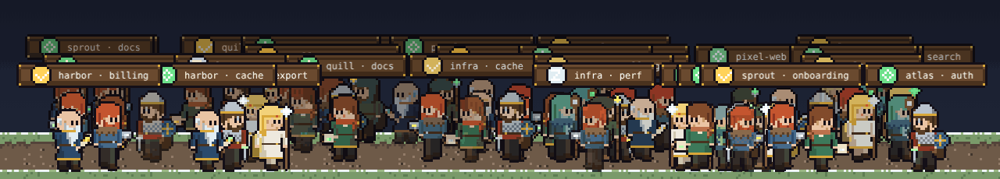

Got more than one monitor? Tick **Span all monitors** under Monitor in the tray menu. The
overlay puts a strip window on the bottom of every monitor and joins them into one long
strip, so parties wander across the seams (here three monitors, 1280, 1920 and 1280 wide):

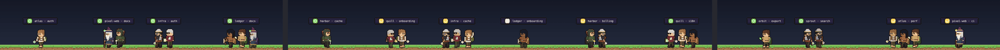

Browser tabs can do the same with `?span=<offset>,<total>` (CSS pixels).

### Map mode

Press **Ctrl+Alt+M** (Cmd+Alt+M on macOS) anywhere, `m` in the page, or pick it in the tray
menu. Every repo becomes a settlement on a pixel world, each party camps beside its repo
with a glow in its status colour, and roads join it all up.

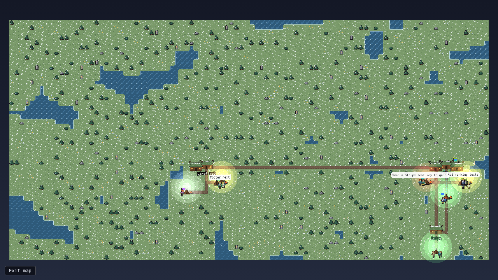

Click a glow, or an orchestrator, to zoom in. A panel lists every member with role, agent,
status and latest line, and each member has a **close** button that closes its pane in
Herdr after a confirm. The panel's **Enter camp** button (or Enter, or a double-click on the
camp) goes inside it, see [Camp](#camp). Esc, the ✕ or a click on empty ground zooms back out,
and the **Exit map** button returns to the strip.

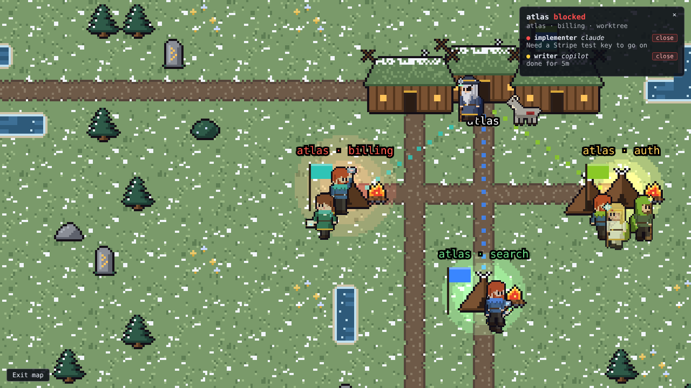

In the desktop overlay the map is a window, not a full-screen takeover: drag the strip at
its top edge to move it, and Bellwether remembers where you left it. It starts centred at
80% of the monitor, and a normal window stacks like any other, so it can sit behind your
editor. To keep it floating above everything, tick **Map window → Always on top** in the
tray menu (off by default; it is saved as `mapAlwaysOnTop` in the overlay's `shell.json`).
**Map window → Reset position** recentres it, and picking another monitor moves it there.
The strip itself always floats on top and lets clicks through.

Orchestrators stand at their repo's settlement and **ride a mount** out to each new
worktree they spawn, with a trail back home. Settlements gain a building for every four
agents and camps gain a tent for every two members, with a small pop as each goes up.
Everyone else mostly stays put at their camp: a small shuffle every few seconds, and they
only walk when it means something (a message to a teammate, a new worktree to ride out to).

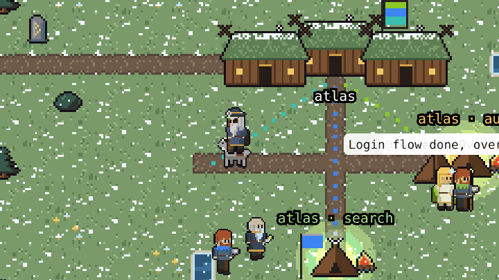

### Camp

Zoom into a worktree and **Enter camp** (or press Enter, or double-click the camp) to see its
party at work, like a pixel camp screen: a campfire in the middle, a tent or two, and every
member at its own station. Esc or **Back to map** returns to the zoomed map, and a second Esc
zooms out.

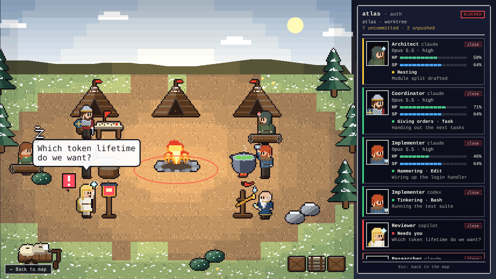

What a member does follows what its agent reports. Where it reports the running tool (the
hooks source does today), the member works at the matching station; without a tool name it
falls back on status:

| Member is | Station and animation |
|---|---|
| using an editing tool (Edit, Write, apply_patch, ...) | hammering at an anvil, sparks flying |
| reading or searching files (Read, Grep, Glob, ...) | reading a book on a lectern, turning pages |
| running a shell command (Bash, PowerShell, ...) | tinkering at a bubbling cauldron |
| on the web (WebSearch, WebFetch) | scouting with a spyglass at a lookout post |
| delegating (Task, Agent) | giving orders at a map table |
| working with no tool, or an unknown one | pacing in front of an easel |
| blocked | hand raised, a flashing `!` and a signal lamp |
| done | resting on a log (and waving now and then) |
| idle | dozing on a log, with rising z's |
| unknown | sitting, with a question mark |

An agent running low on context (under 20%) droops and sweats at its station. If the party's
git state is known, the camp shows it: a crate for every few uncommitted files (up to nine)
and a loaded handcart while there are unpushed commits. Nothing is drawn without git state.
Speech bubbles appear over the speaker.

The window beside the scene is the party breakdown: branch, quest and party status, git state,
and one row per member with a portrait, role, agent, model and effort, HP and SP bars (the
same vitals as the map panel, hidden with `v`), what it is doing, its latest line and the
**close** button. Double-click a row to focus that pane in Herdr.

Every skin brings its own camp: wood and canvas for Workshop Crew, Aesir and Wayfarers, an
outpost bay of plating, holo-lecterns and pods for Deep Space. A skin without camp art
borrows Workshop Crew's.

### Agents talking to each other

Herdr raises no event when one agent prompts another, so `bellwether install` adds a small
pre-tool hook to Claude Code and Copilot CLI. When an agent runs `herdr agent prompt`,
`herdr pane run` or `herdr pane send-text` into another agent's pane, the hook tags the
sender with the first line of the message and who it is for. The overlay shows it as a
bubble addressed `@<role>`, and in map mode the speaker walks (or rides) over to the
listener. Finished hand-offs between teammates are inferred too.

Too chatty? Hide bubbles from the tray menu, with `bubbles = false`, `?bubbles=0`, or by
pressing `b` in the page.

### Vitals

When an agent reports them, each character gets two thin bars on the ground under its feet:
**HP** is the percent of its context window left, **stamina** is the percent of the 5-hour
usage quota left. Below 20% HP the bar turns red and the whole group walks slower. The party
nameplate adds the agent session's name as its quest (`atlas · auth — Fix the login flow`)
when every member that has one shares it, and the map's detail panel lists each member's
model, effort, both bars with their percentages, and quest.

Only Claude Code provides this data today, through its status line, and only the fields it
sends: no quota bar without a Claude.ai subscription, no effort on models that lack it. Run
`bellwether install --statusline` to turn it on. If you already have a status line,
Bellwether wraps it and prints its output unchanged; `bellwether uninstall` puts it back.
Other tools can report the same numbers with `bellwether emit --ev vitals` (see
[the event format](docs/EVENTS.md)). Nothing is estimated: an agent that does not report a
number gets no bar for it. Icon-only labels hide vitals, as do the tray menu's **Vitals**
checkbox, `vitals = false`, `?vitals=0`, and the `v` key in the page.

### Fellowships: orchestrators and worktrees

Parties that share a Herdr session and repo form a **fellowship**. Bellwether works this out
from what Herdr already reports, so agents need no extra instructions. It only needs the
orchestrator's pane to have the `orchestrator` role, and its worktrees to be created in the
same repo (which Herdr's worktree commands do).

## Skins

Skins are theme packs. The core only knows roles (`architect`, `reviewer`, ...); each pack
decides what a role looks like. Pick one in the tray menu, with `pack = "..."` in
`bellwether.toml`, `--pack`, or `?pack=`. All four are original art under Apache-2.0.

Each line-up below shows the nine roles in order: orchestrator, coordinator, architect,
implementer, reviewer, researcher, writer, ops, generic.

### Workshop Crew (`neutral`, default)

A friendly crew of builders, scribes and surveyors in a workshop town.

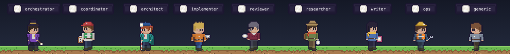
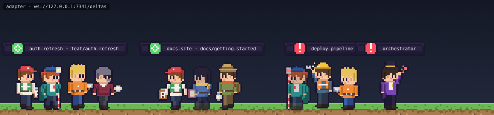
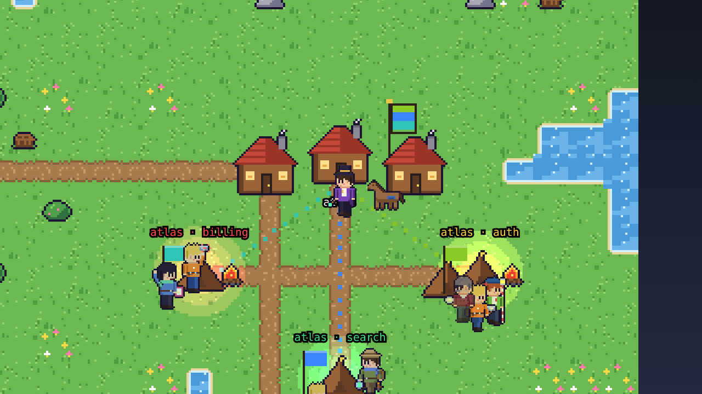

### Aesir (`aesir`)

Gods and folk of the northern sagas, with rune-lit staves, longhouses and a fjord-side map.

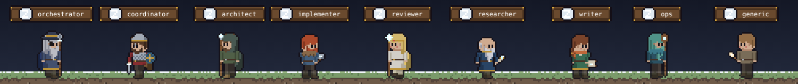

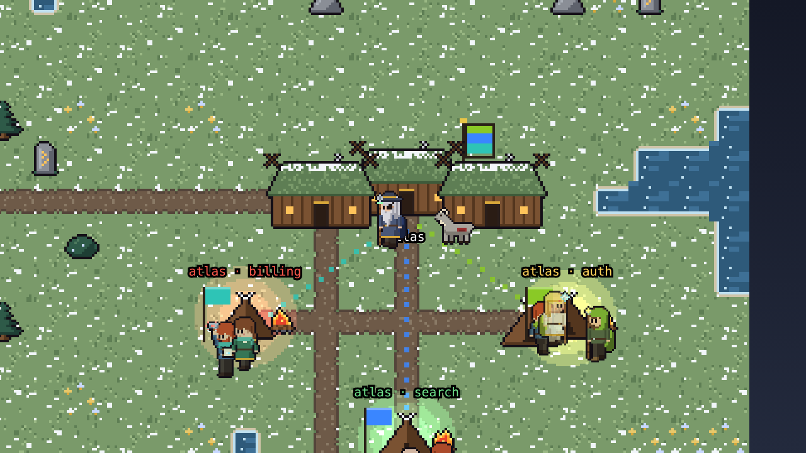

### Wayfarers (`wayfarers`)

An original fantasy quest party setting out from a hill country of burrow houses.

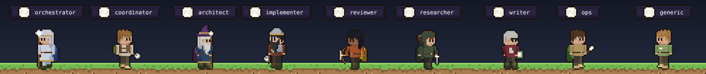
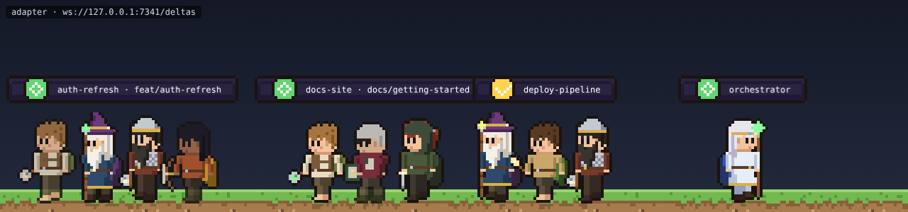
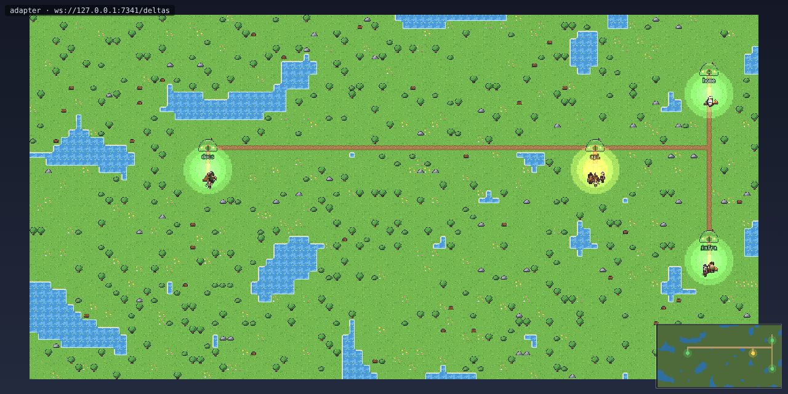

### Deep Space (`scifi`)

A sci-fi survey crew working a glass-domed outpost on a violet-mossed alien world.

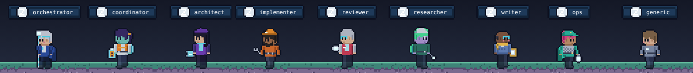
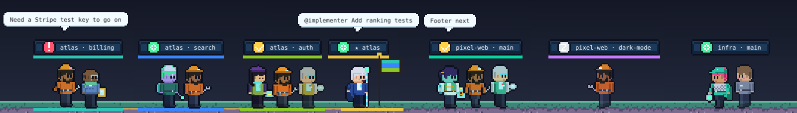
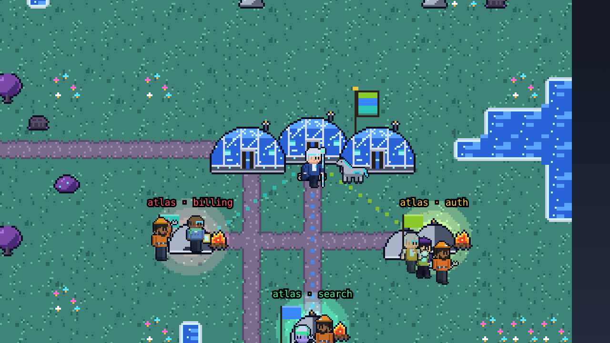

Want your own? Any other folder under `themes/` is a private pack that stays out of git.
See [writing a skin pack](docs/themes.md).

## Giving agents a role

Roles decide which character a pane gets: `orchestrator`, `coordinator`, `architect`,
`implementer`, `reviewer`, `researcher`, `writer`, `ops`, or `generic` (the default). They
are checked in this order:

1. **A pane tag.** The agent runs
   `herdr pane report-metadata "$HERDR_PANE_ID" --source bellwether --token role=reviewer`.
   The skill that `bellwether install` adds teaches agents to do this themselves.
2. **`HERDR_ROLE`.** Start the pane with `HERDR_ROLE=architect`; the installed hook tags it
   when the session starts.
3. **Names.** An agent name (`herdr agent rename`) or pane title containing a role word,
   such as `reviewer-2`. Needs no install.
4. **Orchestration workspaces.** The first pane of a workspace whose label contains
   `Orchestration` is the `orchestrator`.

To have agents tag themselves, add this to `~/.claude/CLAUDE.md` (or `AGENTS.md` /
`.github/copilot-instructions.md` for Copilot):

> When `HERDR_ENV=1`, use the `bellwether` skill at session start: tag your pane with
> your role. Orchestrators tag each pane they spawn with that member's role.

### Start an orchestrator in one command

`bellwether orchestrate` opens a new Herdr workspace named `<folder> Orchestration` in the
current directory, tags pane 1 as the orchestrator and starts your agent in it:

```sh
cd ~/src/myrepo
bellwether orchestrate -- claude
bellwether orchestrate --session overlay-dev --label "api Orchestration" -- copilot --autopilot
```

Options: `--cwd` (default: current directory), `--label` (default `<folder> Orchestration`),
`--role` (default `orchestrator`), `--session` or `--socket` (which Herdr), and `--timeout <ms>`
(how long to wait for the agent, default 60000). Once Herdr detects the agent, the role tag is
applied again and an unnamed agent is named `orchestrator-<repo>`. Leave off the command to
just create the workspace and tag pane 1.

## Where to show it

| You want | Do this |
|---|---|
| A desktop overlay | `bellwether overlay`: transparent, frameless, always on top and click-through, pinned to the bottom of one monitor, or spanning all of them. |
| A stream overlay | `bellwether run`, then an OBS Browser Source on `http://127.0.0.1:7341/?transparent`. See the [OBS guide](docs/obs.md). |
| A browser tab | `bellwether run` and open <http://127.0.0.1:7341/>. |

The desktop overlay's **tray menu** has everything in one place: switch strip and map,
Size, Labels, Chat bubbles, Vitals, Skin, Monitor (or Span all monitors), Herdr Session (all, or one), and Quit. Choices are
remembered between runs.

### Keyboard

| Key | Where | Does |
|---|---|---|
| Ctrl+Alt+M (Cmd+Alt+M) | anywhere, desktop overlay | toggle strip and map |
| `m` | page | toggle strip and map |
| `b` | page | show or hide chat bubbles |
| `v` | page | show or hide vitals (bars, model, quest) |
| Esc | map | zoom back out |
| Enter | map, zoomed on a camp | enter the camp |
| double-click a camp | map | enter the camp |
| Esc, or the Back button | camp | back to the map |
| double-click a row | camp window | focus that pane in Herdr |
| double-click a member | strip, browser | focus that pane in Herdr |

## Configuration

Put a `bellwether.toml` in the directory you run from (it is gitignored):

```toml
source = "auto"          # auto (default for run and overlay): Herdr if it answers at startup, else agent events
                         # live: Herdr only | hooks: agent events only, no Herdr | mock: fake agents
pack = "aesir"           # neutral | aesir | wayfarers | scifi | a private pack
scale = 2                # strip size, 1 to 6 (default 3)
minimal = false          # true: icon-only labels
bubbles = true           # false hides chat bubbles
vitals = true            # false hides context/quota bars, model and quest
scrub = false            # true hashes repo/branch names in recordings

[herdr]
sessions = "all"         # or ["default", "overlay-dev"]
# socket = "..."         # explicit socket or pipe path

[hooks]
# file = "..."           # events file for source = "hooks" (default ~/.bellwether/events.jsonl)
```

Flags and environment variables override it (`--pack aesir` or `BELLWETHER_PACK=aesir`,
`--session <name>` or `--all`, `BELLWETHER_SOURCE=auto`, `live`, `hooks` or `mock`, `--live`, `--hooks`, `--events <file>`, `--port`), and the tray menu or
page URL overrides those. `auto` decides once at startup (a one-second connect probe of the
Herdr socket) and logs which source it picked; it does not switch later, so restart the
overlay after starting Herdr:

| URL option | Effect |
|---|---|
| `?pack=aesir` | Skin pack. |
| `?scale=4` | Pixel scale, 1 to 6. |
| `?mode=map` | Start in map mode. |
| `?mode=camp&party=<id, label or branch>` | Open one party's camp scene (first party if `party` is left out), for OBS. |
| `?panel=0` | Camp scene without the party window. |
| `?minimal` | Icon-only labels (`?minimal=0` for full). |
| `?bubbles=0` | Hide chat bubbles. |
| `?vitals=0` | Hide vitals: bars, model and quest. |
| `?transparent` | No backdrop or status chip, for OBS. |
| `?source=mock` | Mock agents inside the page, no adapter. |
| `?ws=ws://host:port/deltas` | Connect to a specific adapter. |

## CLI reference

| Command | Does |
|---|---|
| `bellwether agents` | Show which coding agents are on PATH and which config dirs exist. |
| `bellwether install [--agent claude\|copilot]` | Add the skill, role hook and message hook to each present agent. Safe to re-run. |
| `bellwether uninstall` | Remove only what `install` wrote. |
| `bellwether overlay [--hooks]` | Open the desktop overlay (Herdr if running, else agent events; `--hooks` forces events). |
| `bellwether install --events` | Also add activity hooks (Claude Code, Copilot CLI) for use without Herdr. |
| `bellwether install --statusline` | Claude Code only: report context, quota, model, effort and session name for vitals, wrapping any status line you have. |
| `bellwether emit --ev <kind> ...` | Append one activity event from any tool (`--ev vitals --ctx N --quota N ...` for vitals). |
| `bellwether hook statusline` | Status line body: reports vitals from the JSON on stdin, then prints the line. |
| `bellwether run` | Serve the overlay on port 7341 (Herdr if running, else agent events; `--live`, `--hooks`, `--mock` force one). |
| `bellwether hook event` | Plugin hook body: appends one event line from a hook payload on stdin. |
| `bellwether orchestrate [...] [-- CMD]` | New `<folder> Orchestration` workspace with pane 1 tagged and running CMD. |
| `bellwether record F [--scrub]` | Run live and append deltas to `F`. |
| `bellwether replay F [--speed n]` | Serve the overlay from a recording. |
| `bellwether scrub IN OUT` | Rewrite a recording with repo, branch and label names hashed and speech removed. |

`run`, `record` and `replay` pass adapter flags through; `--help` lists them.

### What `install` writes

| | Claude Code | GitHub Copilot CLI |
|---|---|---|
| Config dir | `~/.claude` or `$CLAUDE_CONFIG_DIR` | `~/.copilot` or `$COPILOT_HOME` |
| Skill | `skills/bellwether/SKILL.md` | `skills/bellwether/SKILL.md` |
| Hooks | role tag on session start, message tag before `herdr` sends | the same |
| `settings.json` | `SessionStart` and `PreToolUse` entries | `SessionStart` and `PreToolUse` entries |

Herdr's own entries and anything you added stay untouched, and running it twice changes
nothing. A missing config dir is skipped, not created, so start each agent once first. Let
Herdr detect your agents with `herdr integration install claude` (or `copilot`). Older
Copilot CLI builds without skills ignore the skill; the hooks still work.

The adapter itself is agent-agnostic: it reads Herdr's `agent` field and draws `claude`,
`copilot`, `codex` and anything else the same way.

### Record and share a replay

```sh
bellwether record session.jsonl --scrub   # hashes repo, branch and labels
bellwether replay session.jsonl --speed 4
```

Never publish a recording without `--scrub`. `pnpm blog` builds a static, adapter-free page
that plays a scrubbed recording, for embedding in a blog post.

## More

- [Writing a skin pack](docs/themes.md)
- [Using Bellwether in OBS](docs/obs.md)
- [Development: running from source, layout, adapter flags](docs/development.md)
- [Architecture and plan](docs/PLAN.md)
- [Contributing](CONTRIBUTING.md) and [security policy](SECURITY.md)

The screenshots and GIFs in this README are rendered from scripted, made-up agent feeds by
`node tools/docshots/shoot.mjs`.

## License

Apache License 2.0, the same as Herdr. Copyright 2026 Pelotto Technologies. See
[LICENSE](LICENSE). The public skin packs (`neutral`, `aesir`, `wayfarers`, `scifi`) are
original art under the same license.
